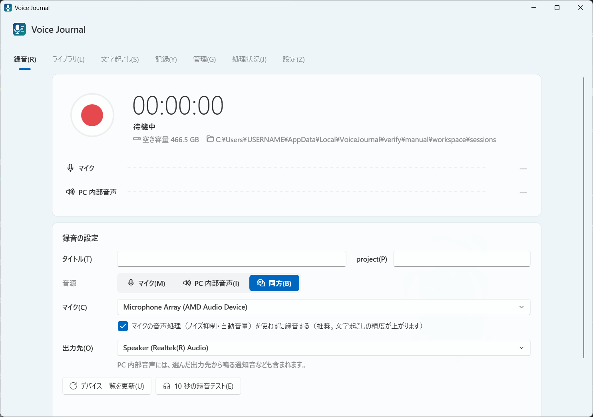

# Voice Journal

Windows の PC の中だけで動く、音声記録のアプリです。会議、独り言、講義などを録音し、録音が終わったあとに文字起こしをして、内容に合った Markdown の記録と、課題・タスクの候補を作ります。候補は、利用者が承認したものだけを管理用のファイルに反映します。

自分用に作ったアプリで、版は `1.0.0-beta.4` です。AI（Claude Code）を使い、仕様書を先に書いてから、フェーズごとに受入試験を通して進めました。



## できること

- **録音**：マイク、PC の内部音声、その両方の3種類。2つの音源は別々のファイルに保存し、原音には手を加えません
- **文字起こし**：whisper.cpp を別のプロセスで動かします（既定のモデルは medium）。修正は前の版を書き換えず、新しい版として残します
- **記録の作成**：アプリが起動する推論エンジン（llama.cpp の `llama-server`）と Gemma 4 E2B で、要約、論点、決定、保留などを整理します
- **課題・タスクの管理**：記録から候補を挙げ、承認したものだけを `issues.md` / `tasks.md` に反映します
- **そのほか**：検索、処理のやり直し、バックアップと復元、診断情報の書き出し

## 設計で考えたこと

- **通信は PC の外に出しません。** 推論エンジンへの接続はループバックだけを許し、アプリが起動ごとに空きポートとランダムな API キーで立ち上げ、使わなければ終了させます。実行ファイルとモデルは SHA-256 で登録し、一致しないものは動かしません。
- **正本はファイルで、DB は索引です。** 録音ごとの `manifest.json` と音声ファイル、文字起こしの版のフォルダーが正本で、SQLite はそこから作り直せる索引です。
- **AI に既存のファイルを直接書かせません。** 反映は「変更計画 → 利用者の承認 → 反映」の順で行い、変更前のハッシュが違えば止めます。反映の途中でプロセスが落ちても、バックアップから戻せます（12か所で実際に強制終了して確かめました）。
- **録音の時刻は、パケットを取得した時刻（QPC）で決めます。** デバイスの時計のずれは原音を補正せず、時刻の対応として記録します。
- **中心のロジックを Windows から切り離しました。** `VoiceJournal.Core` は WPF、NAudio、SQLite、LLM に依存せず、単体でテストできます。

## 進め方

[詳細仕様書](docs/VoiceJournal_アプリ詳細仕様書.md)を正本にして、フェーズごとに計画書と報告書を残しながら進めました。受入試験（AT-xx）は `scripts/Test-Phase*.ps1` で繰り返し実行できるようにし、懸念が残る項目は合格にしていません。

| フェーズ | 内容 | 状態 |
|---|---|---|
| A | 環境の固定・技術の検証 | 完了（[environment-lock.md](docs/environment-lock.md)） |
| B | 録音・保存 | 受入試験に合格（[報告](docs/phase-b-report.md)） |
| C | 文字起こし | 受入試験に合格（[報告](docs/phase-c-report.md)） |
| D | 記録の作成 | 完了（[報告](docs/phase-d-report.md)） |
| E | 課題・タスクのレビュー | 完了（[報告](docs/phase-e-report.md)） |
| F | 安全な反映・復旧 | 完了（[報告](docs/phase-f-report.md)） |
| G | 運用・配布 | 途中（[報告](docs/phase-g-report.md)） |

文字起こしのモデル（small、medium、large-v3-turbo、kotoba-whisper）は、読み上げた原稿の録音で文字誤り率と速さを測って選びました。記録を作るモデルは、架空の会話の評価データ（[tests/eval/phase-d](tests/eval/phase-d/README.md)）で、課題・タスクの抽出の precision と recall を測って選びました（受入時は precision 0.967、recall 0.983）。経緯は各フェーズの報告書にあります。

## 構成

```
src/
  VoiceJournal.App/             画面（WPF・MVVM）
  VoiceJournal.Core/            録音の制御、文字起こし、記録、管理反映のロジック（OS に依存しない）
  VoiceJournal.Infrastructure/  音声（NAudio・WASAPI）、whisper.cpp、llama-server、SQLite
tests/
  VoiceJournal.Tests/           xUnit のテスト
  eval/phase-d/                 記録の作成を評価するデータ（架空の会話）
tools/VoiceJournal.AudioProbe/  受入試験で使うコマンドラインの道具
scripts/                        受入試験、インストーラー、説明書の作成
installer/                      WiX 6 のインストーラー（自分のユーザーだけに入れる MSI）
docs/                           仕様書、各フェーズの計画書と報告書、性能の報告、説明書
```

## 規模

- C# のソース 121 ファイル（`src`）、テスト 50 ファイル（`[Fact]` / `[Theory]` 473 か所）
- 2026年10月31日から開発し、コミットは 186 です

## ビルド

.NET 10 SDK が要ります。

```powershell
dotnet build VoiceJournal.slnx
dotnet test VoiceJournal.slnx
```

動かすには、whisper.cpp、llama-server、モデル（whisper と Gemma の GGUF）を別に用意して登録する必要があります。使った版とハッシュは [environment-lock.md](docs/environment-lock.md) にあります。モデル、音声、DB はこのリポジトリに含めていません。

## 制約

- 個人用のアプリで、利用者は1人です。動作を確かめたのは開発に使った PC（Windows 11、Ryzen AI 9 HX 375、メモリ 32GB）だけです
- 8時間の連続録音と、録音中のスリープからの復帰は、実機で確かめていません
- PC が熱いときは、30分の音声の記録づくりが目標の8分を数秒超えることがあります
- フェーズ G（運用・配布）は、LAN を切った状態での試験などが残っています

## ライセンス

[MIT License](LICENSE) です。whisper.cpp、llama.cpp、Gemma のモデルは同梱しておらず、それぞれのライセンスに従います。使っている部品の一覧は [third-party-notices.md](docs/third-party-notices.md) にあります。
